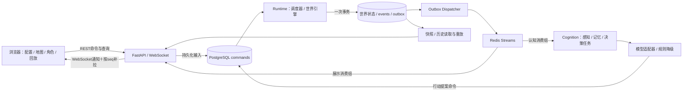

# 基于EDA的多智能体校园仿真沙盒：八周项目规划

版本：v1.0 · 2026-11-02 · 团队：共3人 · 已选方案：轻量校园小镇

本规划优先满足“架构设计与产品完整度”。范围、性能和工时均为规划目标，尚未通过实现验证。暂按每人每周18小时计算：3×8×18＝432人时，其中约324人时用于功能，108人时用于评审、联调、测试、部署与文档。若实际投入更少，按文末裁剪顺序收缩范围，保留核心闭环。

## 1. 项目背景与目标

### 1.1 背景与问题

生成式智能体可以结合角色设定、经历与当前环境进行交流和决策。斯坦福Generative Agents以记忆、检索、反思和规划组织智能体行为，展示了25个角色组成的小镇。其研究说明这些认知机制有助于形成可信行为，但不能直接保证一个课程项目的运行可靠性或交付完整度。[论文](https://arxiv.org/abs/2304.03442)

本项目解决的工程问题是：多个异步智能体共同生活在一个持续变化的世界里时，怎样协调动作、处理外部干预、解释行为并可靠地保留历史？典型冲突包括：模型回复时场地已经关闭；用户暂停后迟到的动作仍改变世界；消息重试导致同一通知或动作重复执行；模型不可用使整个仿真停住。

EDA适合把世界变化表达为可订阅的事实，让感知、认知、展示与统计通过事件协作。本项目的价值在于完整实现这个过程，而不是仅为聊天调用增加一层消息队列。

### 1.2 产品定位

面向教学演示、行为观察与架构验证的Web仿真工具。用户作为观察者和实验操作者，配置角色、启动校园世界、注入受约束的事件，查看角色如何响应，并回看完整过程。

建议项目名：**校园涌现：基于事件驱动的多智能体仿真沙盒**。

主场景：校园社团活动筹备。组织者发布邀请，角色依据兴趣和安排选择行动；活动室临时关闭后，角色通过观察或消息获知变化，调整计划或通知他人。

### 1.3 交付目标与成功标准

| 目标 | 八周验收证据 |
| --- | --- |
| 完整产品闭环 | 新建仿真→配置→运行→干预→检查角色→停止→回放→导出摘要可连续完成 |
| 多智能体自主行为 | 默认8名角色可执行移动、交谈、等待、参与活动；同一通知下存在不同响应，不要求固定剧情 |
| EDA设计有效 | 同一事件可被认知、展示等独立订阅者处理；新增统计订阅者不修改世界状态处理逻辑 |
| 状态一致 | 重复消息、迟到模型响应、暂停/停止、场地变化均有明确规则和验证用例 |
| 可观察、可回放 | 每个已执行关键动作关联触发事件和决策摘要；历史回放不调用大模型 |
| 可运行、可交接 | 在约定环境用Docker Compose启动；提供初始化数据、配置示例、故障说明和演示脚本 |

### 1.4 范围边界

**必做P0：**1张二维地图、5个地点、默认8名角色、1个活动场景、角色设定编辑、运行/暂停/继续/停止、3种事件模板、记忆查看、决策依据、事件时间线、只读历史回放、基本指标、故障降级、部署与测试文档。

**选做P1：**扩展到12名角色、1×/2×节奏选择、记忆摘要、从同一配置发起多次运行并比较指标、角色关系视图。P1仅在P0验收后进入。

**本期不纳入：**3D、地图编辑器、完整物理碰撞、实时多人联机、通用插件市场、模型训练、多模型辩论、历史分支续跑、跨服务器世界、多租户和完善权限系统。MVP只在本地或受控教学环境部署；若要求公网访问，再安排认证与访问控制。

## 2. 用户画像与需求分析

### 2.1 用户画像

| 用户 | 主要任务 | 痛点 | 对应产品能力 |
| --- | --- | --- | --- |
| 实验操作者：学生、教师 | 调整角色和事件，观察行为差异 | 启动复杂；无法控制场景；重复实验难 | 预置模板、配置校验、事件干预、保存运行记录 |
| 观察者与评审者 | 在几分钟内理解系统与设计价值 | 只看到人物移动或聊天，不知道因果 | 地图、角色面板、事件时间线、行为依据、回放 |
| 项目维护者：开发团队 | 定位异常、扩展行为和事件 | 异步链路难排查，故障难重现 | 关联ID、结构化日志、重试记录、契约、规则模式 |

这三类是使用情境，不要求实现三套账号或权限。

### 2.2 核心用户旅程

1. 选择“社团活动筹备”模板，默认加载8名角色和5个地点。
2. 调整角色兴趣、目标与初始位置，检查模型连接并设置本次调用上限。
3. 启动仿真，观察日程驱动的移动和附近交流。
4. 发布活动通知，明确选择公告范围；随后关闭活动室。
5. 点击角色，查看其已知信息、相关记忆、当前计划及最近一次决策摘要。
6. 点击动作对应事件，查看其直接原因和后续结果。
7. 暂停或停止；进入历史回放，拖动时间轴，导出实验摘要。

### 2.3 功能需求与验收

| 编号/优先级 | 用户需求 | 验收方式 |
| --- | --- | --- |
| F01/P0 | 从模板创建并保存仿真 | 名称、8名角色、地图和活动配置持久化；缺失必填字段时定位提示 |
| F02/P0 | 编辑角色 | 可改角色简介、兴趣、目标、日程与起点；运行中锁定配置，避免历史含义改变 |
| F03/P0 | 控制运行 | 状态机约束按钮；重复点击不重复执行；刷新页面能恢复观察 |
| F04/P0 | 注入事件 | 支持发布通知、关闭地点、更改活动时间；提交后展示“已接收→已生效/被拒绝” |
| F05/P0 | 观察世界 | 显示位置、行动、仿真时间、场地状态；点击角色/地点展示详情 |
| F06/P0 | 检查认知 | 查看角色已感知事实、最近记忆、当前目标、决策摘要和引用记忆；未知事件不进入提示词 |
| F07/P0 | 检查事件 | 按角色、类型、时间过滤；从动作定位触发事件和结果 |
| F08/P0 | 保存并回放 | 完成或暂停的运行可只读回看；还原到事件序号，回放不改变原运行、不请求模型 |
| F09/P0 | 查看与导出结果 | 显示事件数、行动数、活动参与人数、模型调用/Token、失败与降级次数；导出JSON/CSV |
| F10/P0 | 获得故障反馈 | 模型超时、断线、队列积压、预算耗尽均可见；模型故障下可继续规则行为 |
| F11/P1 | 比较实验 | 同一初始配置新建两次独立运行，对比覆盖与参与情况；不承诺统计显著性 |

### 2.4 关键业务规则

- 地图为5个地点组成的可通行图：宿舍、教学楼、图书馆、食堂、活动室。移动依据固定路线与耗时；人物之间允许视觉重叠，本期不做物理避碰。
- 每名角色只有一个正在执行的动作，且最多一个有效认知任务。移动由引擎持续推进，模型不逐帧控制坐标。
- 对话限制为两人、同地点、双方可用；一段对话最多4条发言。对话占用双方状态，并有结束与超时机制。
- 角色只能获得同地点可观察信息、发给自己的消息及所选公告范围内的通知。模型不能读取完整世界日志。
- 场地关闭立即影响通行约束；在场角色感知关闭，其他角色通过通知或到达尝试得知。关闭时在场角色退出至相邻开放地点，行动被中断并记录原因。
- “更改活动时间”改变权威日程，但不会自动更新所有角色的知识；受影响组织者先获知，再通过交流传播。距离开始过近或已结束的修改可被规则拒绝。
- 不要求每个角色参加活动，也不预设通知一定传播给所有人。验证合法行为与信息边界，避免用“精彩故事”作为稳定性验收条件。

### 2.5 非功能目标

以一台约4核、8GB内存开发机、8名角色、单个运行、2个观察页面作为初始验证条件；模型服务在机外，条件需记录进测试报告。

| 指标 | 目标及口径 |
| --- | --- |
| 持续运行 | 规则模式连续30分钟无崩溃；真实模型模式完成一次10分钟实验 |
| 操作反馈 | 非模型API p95小于500ms；已提交世界变化到页面显示p95小于1秒，不含模型推理时间 |
| 暂停 | 请求后下一个调度边界进入暂停，目标1秒内；进入PAUSED后仿真时间与权威世界状态不变 |
| 重复处理 | 同一输入重复投递10次，世界效果只发生一次；允许重复传输，不允许重复业务效果 |
| 历史一致 | 保存快照对应状态与事件重放结果的规范化哈希一致；忽略传输时间等非世界字段 |
| 恢复 | 应用重启保留已提交记录；未完成输入可重处理；运行恢复为暂停，用户确认继续 |
| 成本 | 设置每次运行请求数与Token上限；达到上限后明确切换规则模式，Token未知时保留unknown标记 |
| 可用性 | 演示者无需读代码能完成主流程；覆盖空态、加载、错误、重连、禁用、结束状态 |

## 3. 总体架构与技术选型

### 3.1 架构决策

采用**模块化单体代码库＋少量进程角色＋持久化事件分发**。同一后端代码库按API、Runtime、Cognition三种入口运行；共享领域模型和数据库迁移，不拆成独立微服务。

理由：三人八周需要明确边界与异步隔离，同时避免独立服务版本、服务发现和分布式事务开销。EDA是模块之间的协作方式，不依赖微服务数量。



Redis承载实时分发，PostgreSQL是权威持久化源。UI和认知模块不能依赖Redis作为唯一历史记录。Streams具有消费组与确认机制，可用于未确认消息管理；它本身不保证业务副作用只执行一次。[Streams](https://redis.io/docs/latest/develop/data-types/streams/)、[XREADGROUP](https://redis.io/docs/latest/commands/xreadgroup/)

### 3.2 模块边界与所有权

| 模块 | 职责 | 不能做什么 |
| --- | --- | --- |
| Experiment | 模板、角色、配置、运行记录 | 运行后直接篡改本次初始配置 |
| World | 地点、移动、行动、日程、对话占用、状态规则 | 等待模型返回、直接调用模型 |
| Runtime | 仿真时钟、命令顺序、动作完成调度、暂停/恢复 | 每个tick让所有角色调用模型 |
| Cognition | 感知范围、记忆、上下文选择、行动提案 | 直接更新位置、通行状态、活动参与记录 |
| Eventing | 事件契约、Outbox、分发、去重、重试 | 把“收到消息”当成“状态已经改变” |
| Read/Replay | 查询、快照、只读回放、摘要统计 | 通过重新调用模型生成过去 |
| Observability | 关联日志、耗时、积压、调用量 | 把API密钥或无关敏感配置写入日志 |

**单一写入规则：只有世界引擎可以修改权威世界状态。**认知模块可以写记忆与任务状态，但只能通过命令申请世界动作。

### 3.3 事件与命令

命令表达意图，可被拒绝，如`CloseLocation`、`ProposeAction`；领域事件表达已经生效的事实，如`LocationClosed`、`ActionStarted`。`202 Accepted`只表示命令已持久化，前端要等处理结果才能显示“已生效”。

核心领域事件：`RunStarted`、`RunPaused`、`RunResumed`、`RunStopped`、`NoticePublished`、`LocationClosed`、`ActivityTimeChanged`、`AgentObserved`、`DecisionRequested`、`DecisionRecorded`、`ActionStarted`、`AgentArrived`、`MessageDelivered`、`ActionInterrupted`、`ActionRejected`。处理失败等运维记录放在独立任务/日志数据中，避免递归生成领域事件。

每个事件统一携带：

```json
{
  "event_id": "evt-00042",
  "run_id": "run-001",
  "seq": 42,
  "type": "LocationClosed",
  "schema_version": 1,
  "sim_time_ms": 420000,
  "occurred_at": "2026-11-02T02:00:00Z",
  "correlation_id": "trace-007",
  "causation_id": "cmd-007",
  "payload": {"location_id": "activity-room", "reason": "临时维护"}
}
```

`seq`只在单次运行内递增，不依赖机器墙钟排序。首个原因可以是命令ID，后续原因引用事件ID。事件结构改动需要明确版本，回放代码按版本处理。

### 3.4 一条完整业务链

1. 用户提交“关闭活动室”，API校验格式并持久化命令，返回`command_id`。
2. Runtime按运行串行取命令；在短事务中锁定run行，校验、更新地点状态，分配seq，写事件与Outbox，标记命令结果，再提交。
3. Dispatcher将Outbox事件发送到Streams；发布成功后标记。发布成功但标记失败会造成重复投递，由消费者去重。
4. 认知订阅者筛选受影响角色，持久化已处理事件、观察记忆和决策任务后ACK；其他角色不会因为系统记录了关闭事件就“自动知道”。
5. Worker读取任务，调用模型生成行动提案；记录结构化结果、可见的决策摘要和引用记忆ID，再向commands写入提案。
6. 世界引擎验证角色状态、地点是否开放、run_epoch、agent_plan_version、相关资源版本及有效期。无效提案被拒绝或触发重规划，有效动作落库并产生事件。
7. 展示订阅者向页面发出更新提示；页面按seq拉取权威增量。历史数据来自PostgreSQL，不从实时传输缓存拼凑。

### 3.5 时间模型与一致性

- **三种时间分离：**仿真时间用于移动、日程和动作；墙钟时间用于请求超时；前端帧时间只用于平滑插值。
- Runtime可以每250ms检查到期动作和输入，仿真默认1×。只有有意义的状态变化写领域事件，不记录每帧渲染位置。
- 持久化动作的起点、终点、开始与结束仿真时间；任意时刻位置由确定性插值计算。暂停后sim_time停止，前端不能继续外推。
- **单run串行执行：**锁住run行后执行短事务；模型调用与网络分发都在事务外。MVP只运行一个Runtime实例，数据库约束作为重复启动保护。[PostgreSQL锁机制](https://www.postgresql.org/docs/current/explicit-locking.html)
- **短事务原子提交：**世界状态、领域事件、Outbox和输入处理结果要一起提交。
- **投递至少一次：**`(consumer_name,event_id)`唯一约束；去重标记与该消费者的数据库副作用在同一事务；提交后才ACK。
- **广播与分工区分：**认知和展示使用不同消费组；同一组的多个Worker分担工作，不把同一组误当成多模块广播。
- **顺序控制：**单Dispatcher按run内seq发布；消费者检查版本和缺口。严格依赖先后关系的处理从事件表补读，不假设并行Worker完成顺序一致。
- **失败回收：**过期pending由`XAUTOCLAIM`等方式接管；数据库任务记录尝试次数，超过3次进入失败记录，可手动重试。与模型请求超时分开配置，避免长请求被反复抢占。[XAUTOCLAIM](https://redis.io/docs/latest/commands/xautoclaim/)
- **Redis中断：**世界变化保留在PG并积压Outbox，恢复后继续分发；Redis数据丢失可按PG游标重新发布，幂等消费者承受重复。不是以Redis备份替代持久化设计。
- **外部调用边界：**Worker崩溃时无法总能判断模型服务是否已收费；因此不承诺模型请求恰好一次，预算需为有限重试留余量。

### 3.6 暂停、停止与恢复

运行状态：`DRAFT → READY → RUNNING ↔ PAUSED → FINISHED`，RUNNING也可直接停止到FINISHED；不可恢复的异常进入FAILED。

- 暂停命令在调度边界生效并产生`RunPaused`。不再推进仿真时间，不应用世界行动；控制命令仍可处理。
- 暂停期间模型请求可结束并保存任务结果，但提案暂存，继续后重新验证；注入新事件的入口暂时禁用，避免“暂停却改变世界”的语义冲突。
- 停止操作需要一次确认；将run_epoch递增，未应用提案全部失效。结束状态只能观察与回放。
- 应用重启后把未结束运行恢复为PAUSED，记录恢复原因；用户继续后处理未完成输入。重新分配任务时使用唯一键防止重复。
- 校验提案使用角色计划版本与相关资源版本，不用“整个世界版本必须完全一致”，避免无关角色移动使所有提案失效。

### 3.7 智能体设计与费用控制

每名角色包括：简介、兴趣、目标、简化日程、当前位置/动作、已知信息与记忆。认知流程为“观察→写记忆→选取相关上下文→提出结构化行动→引擎校验执行”。

记忆先用PostgreSQL保存自然语言内容、来源事件、仿真时间、重要性标签与主题。检索按时间衰减、主题匹配和重要性加权，取Top-K；MVP不引入独立向量数据库。反思和向量检索保留为P1，研究项目中的完整认知机制不作为本期硬性要求。

模型只在新通知、重要交流、目标完成、动作失败等决策点调用；普通移动、等待、日程切换由规则驱动。多条近邻刺激合并，每名角色最多一个未完成任务，并记录是否需要在任务结束后再评估。

输出Schema限制动作枚举为`MOVE/TALK/WAIT/JOIN_ACTIVITY`，包含目标、短决策摘要、引用记忆ID；摘要是产品解释信息，不索取或展示模型隐含推理过程。对话内容按文本渲染，不当作指令或HTML执行。[Pydantic模型与校验](https://docs.pydantic.dev/latest/concepts/models/)

初始参数：全局模型并发2、单次请求超时20秒、最多1次请求重试、单次输出不超过约300 Token；参数须在第3—4周用真实服务校正。失败后执行等待或合法日程动作，并明确标记降级来源。

初始运行上限建议120次请求，输入上限约2000 Token/次、输出约300 Token/次，对应最多约24万输入和3.6万输出Token的预算估计；修复、重试、对话均计入请求上限。并发任务通过预算预留防止超发。真实费用按所选服务当天价格计算，不固定货币金额；需要价格时另行核验。

### 3.8 技术栈

| 层次 | 推荐 | 选择理由与边界 |
| --- | --- | --- |
| Web应用 | React＋TypeScript＋Vite | 配置表单、面板、状态可维护；版本在第1周固定并提交锁文件 |
| UI组件 | Ant Design | 减少表单、抽屉、表格和反馈组件开发量；地图使用独立样式 |
| 二维地图 | SVG＋CSS插值 | 8名角色、5地点足够；点击、路径和状态容易实现，不引入游戏引擎 |
| 前端状态 | TanStack Query＋少量Zustand状态 | 区分服务器查询缓存与当前选择/回放游标；权威世界以服务端为准 |
| 后端API | Python＋FastAPI＋Pydantic | 异步接口、事件契约、OpenAPI和WebSocket统一；不在API进程做长时认知 |
| 数据访问 | SQLAlchemy＋Alembic | 事务与迁移可审查；每个并发任务独立Session |
| 权威存储 | PostgreSQL | 世界状态、命令、事件、Outbox、任务、记忆和快照存于同一事务体系 |
| 消息分发 | Redis Streams | 消费组、ACK、pending回收；不使用只有即时通知能力的Pub/Sub替代可靠事件分发 |
| 模型接入 | 一层自建Adapter | 实现一种真实服务接口与FakeProvider/规则模式；不同时叠加多个Agent编排框架 |
| 实时更新 | REST命令＋WebSocket通知 | 单向更新为主；断线按事件seq补拉或重新加载快照 |
| 测试 | pytest＋真实PG/Redis集成测试＋Playwright | 核心验证事务、重复消费、状态规则与用户闭环 |
| 部署 | Docker Compose | frontend、api、runtime、cognition、postgres、redis；数据库迁移作为启动步骤 |

FastAPI支持WebSocket；SQLAlchemy异步Session需按并发任务管理；Compose可统一定义多容器环境。这些能力支持选型，但本项目的性能和可靠性仍需实测。[FastAPI](https://fastapi.tiangolo.com/advanced/websockets/)、[SQLAlchemy](https://docs.sqlalchemy.org/en/20/orm/extensions/asyncio.html)、[Docker Compose](https://docs.docker.com/compose/)

### 3.9 最小数据模型与API

| 数据 | 关键字段/约束 |
| --- | --- |
| experiments / agent_profiles | 模板、角色、可编辑配置；运行时复制为不可变config_snapshot |
| runs | 状态、sim_time、run_epoch、last_seq、配置、预算 |
| agent_states / location_states / activities | 当前权威状态、计划版本、资源版本、活动安排与参与记录 |
| commands | request_id唯一、类型、payload、pending/applied/rejected、结果事件ID |
| events | event_id唯一、(run_id,seq)唯一、type、version、时间、因果ID、payload |
| outbox | event_id唯一、发布时间、重试次数、下一次尝试时间 |
| consumer_receipts | (consumer_name,event_id)唯一；与消费者副作用原子提交 |
| memories / decision_jobs | 来源事件、角色、内容、状态、唯一任务键、输入上下文版本 |
| model_calls | 耗时、请求状态、Token、模型/提示词版本、规则或模型来源 |
| snapshots | run_id、seq、sim_time、schema_version、世界状态和规范化hash |

API主干：`POST /experiments`、`PATCH /experiments/{id}`、`POST /runs`、`POST /runs/{id}/commands`、`GET /runs/{id}/state`、`GET /runs/{id}/events?after_seq=`、`GET /runs/{id}/agents/{agent_id}`、`GET /runs/{id}/replay?seq=`、`GET /runs/{id}/summary`、`WS /runs/{id}/updates`。

只读回放：从最近快照开始，按seq应用已保存的领域事件；不重新进行规则决策或模型推理。所有影响世界的变化必须记录足够重放的信息，包括动作参数、对话文本、资源变化、随机选择的最终结果。建议每100个事件或每60仿真秒产生快照。回放中的角色详情只展示当时已发生的认知记录，避免把未来记忆泄漏进过去。

本期采用“当前状态＋完整领域事件记录＋Outbox＋快照”，不扩展到全系统事件溯源、CQRS基础设施或历史分支。只读回放恢复的是历史世界视图，不恢复模型内部状态。

### 3.10 开源借鉴与原创工作

| 来源 | 借鉴 | 本项目自行完成 |
| --- | --- | --- |
| Stanford Generative Agents | 记忆、检索、计划的组织方式 | 精简角色机制、事件感知和约束执行 |
| AI Town | 世界/引擎/智能体/前端分层，异步认知思路 | PG/Streams协作、幂等、暂停语义与回放 |

AI Town架构文档明确采用tick模型和Convex；因此本项目不直接继承它作为EDA完成证明，也不在三人八周内同时重构其完整引擎。[AI Town架构文档](https://github.com/a16z-infra/ai-town/blob/main/ARCHITECTURE.md)

建立第三方来源清单，记录复用代码/素材路径、版本和许可证。仓库代码许可证不能自动覆盖所有美术素材；地图优先自绘简单图形。

## 4. 产品交互原型设计

此处为低保真设计规格，配套PNG是静态线框图，尚未实现可点击应用或后端服务。

### 4.1 信息架构与页面

| 页面 | 核心内容 | 首要操作 |
| --- | --- | --- |
| P01 仿真实验列表 | 模板、新建入口、已有运行、状态、最近时间、空态 | 新建 / 继续观察 / 回放 |
| P02 创建与配置 | 名称→8名角色→活动与调用上限；模型连接检查；默认模板 | 保存草稿 / 创建运行 |
| P03 运行工作台 | 顶部运行控制；左侧角色列表；中央地图；右侧角色/地点详情；底部事件时间线 | 暂停 / 注入事件 / 选择角色 |
| P04 事件注入弹窗 | 模板、目标、范围、内容/参数、校验提示 | 提交命令并跟踪结果 |
| P05 历史与摘要 | 只读地图、时间轴、事件详情、结果统计、导出 | 拖动回放 / 查看原因 / 导出 |

运行工作台线框图：[prototype/workbench.png](prototype/workbench.png)。配置、事件注入、回放线框图：[prototype/journey.png](prototype/journey.png)。

### 4.2 工作台布局

```text
┌ 实验名 / 运行状态 / 仿真时间 ───── 暂停  注入事件  停止 ┐
│ 角色列表       │ 二维校园地图                 │ 角色详情 │
│ 搜索/状态      │ 5个地点、路线、角色          │ 目标/行动 │
│ 学生/组织者    │ 点击角色定位并打开详情       │ 已知信息  │
│ 教师           │ 点击地点查看开放状态         │ 相关记忆  │
│                │                              │ 决策依据  │
├ 事件时间线：角色筛选 / 类型筛选 / 点击查看前因后果 ──────┤
└ 运行概况：活动参与、模型调用、异常与降级                ┘
```

主界面使用“发布通知”“场地关闭”“当前行动”等用户语言。技术ID、消费重试等内容放在“技术详情”折叠区。角色面板提供：概况、记忆、决策记录三项切换。

### 4.3 三条关键交互

**流程A：创建并启动。**选择模板→填名称→检查角色与地点→设调用上限→创建→READY工作台→点击启动→RUNNING。模型检查失败时提供重试或明确选择规则模式；不把调用失败伪装成模型成功。

**流程B：干预并解释。**点击注入事件→选择“场地关闭”→选活动室→填原因→提交→显示已接收→等待已生效→地图更新关闭状态→选择受影响角色→查看“原行动中断/新计划”→点击原因跳转关闭事件。若规则拒绝，弹窗保留输入并给出原因；双击提交不生成两条命令。

**流程C：停止与回放。**点击停止→确认后进入结束摘要→打开回放→拖动时间轴→按事件步进→选择角色查看当时的目标和已知信息→退出回放回到摘要。历史查看与当前运行状态使用独立视图状态，不相互覆盖。

### 4.4 交互状态规范

| 状态 | 界面行为 |
| --- | --- |
| 加载 | 骨架与明确加载区域；避免空白地图被误认为无人 |
| 运行 | 显示仿真时间、可暂停与干预；模型等待显示“正在决策”，其他角色继续运行 |
| 暂停请求中 | 按钮显示处理中；收到RunPaused再显示已暂停 |
| 已暂停 | 地图与仿真时间冻结；继续/停止可用，注入事件禁用并解释原因 |
| 断线 | 显示重连；禁用操作按钮，连接恢复后重取状态并按seq补拉 |
| 模型故障 | “本角色暂用规则行动”；提供运行级故障摘要，页面仍可操作 |
| 预算耗尽 | 明确显示规则模式；已预留请求按规则收尾，不继续分配新额度 |
| 空结果 | 说明尚无事件/记忆/历史，并给出启动或选择角色的下一步 |
| 回放 | 显著“历史回放”标识；禁用世界控制，只保留播放、拖动、步进 |

### 4.5 原型走查标准

找至少2名未参与开发的同学，分别完成创建、干预、定位行为原因、回放四项任务。记录完成与失败原因；每项不超过2次口头提示，优先修复阻断任务的问题。第2周走查静态原型，第6周走查真实应用。

## 5. 开发迭代计划

### 5.1 人员职责

| 成员 | 主责 | 必须共同承担 |
| --- | --- | --- |
| A：架构与引擎负责人 | 事件契约、世界规则、调度、PG事务、回放 | 与B共审并发/幂等；与C联调状态接口 |
| B：智能体与可靠性负责人 | 感知、记忆、模型Adapter、Streams、Outbox、故障恢复 | 真实服务验证、集成测试、部署 |
| C：产品与前端负责人 | 需求/原型、配置、地图、时间线、历史、摘要 | E2E、可用性走查、演示材料 |

所有关键模块至少有一名非作者完成审阅；每周合并一个可运行版本。不把测试留给单独一个人，也不让架构负责人独占全部文档与部署。

### 5.2 八周迭代与验收门槛

| 周 | A：引擎/架构 | B：认知/消息 | C：产品/前端 | 当周必须演示的结果 |
| --- | --- | --- | --- | --- |
| W1 范围与技术骨架 | 场景规则、数据模型、事件v1、状态机、API契约；PG迁移 | Compose；Streams往返；真实模型最小调用＋FakeProvider | 完成需求、静态线框图、列表/配置/工作台骨架 | 浏览器提交一个命令→落库→引擎产生事件→分发→页面显示；三人能启动环境 |
| W2 规则闭环 | 5地点路线、8角色规则移动、动作完成、运行/暂停/停止 | Outbox发布、消费去重、任务Schema、结构化日志 | 配置保存、地图、角色选择、控制反馈；原型走查 | 不用模型完成新建→运行→暂停→继续→停止；重启后能看到记录 |
| W3 智能体最小版 | 行动校验、角色占用、epoch/计划版本防护 | 观察范围、记忆Top-K、模型决策、并发/超时/预算、规则降级 | 角色概况/记忆/决策面板、模型状态 | 8角色中有真实模型驱动的合法行为；模拟超时后仍能继续；无全知信息泄漏 |
| W4 场景联动 | 通知、地点关闭、活动时间变更、对话与参与规则 | 受影响角色筛选、对话调用上限、事件合并、pending回收 | 注入弹窗、已接收/生效反馈、事件筛选、因果跳转 | “通知→交流→关闭→重规划”闭环；重复注入不重复生效；提交后旧提案不能进入关闭场地 |
| W5 历史与恢复 | 快照、确定性reducer、seq回放、恢复为暂停 | 故障重试/失败记录、进程崩溃与Redis中断验证 | 历史列表、回放时间轴、按事件步进、摘要初版 | 历史回放零模型调用；快照hash一致；杀进程后未确认消息可恢复且无重复效果 |
| W6 产品完成 | 补齐边界规则和数据导出 | 调用量/延迟/积压指标、真实模型成本校准 | 加载/空态/错误/重连/结束页、导出、可用性走查 | P0全功能可用；E2E四条主流程通过；进入功能冻结 |
| W7 验收与修复 | 集成/一致性/回放用例、修复高优先缺陷 | 30分钟规则运行＋真实模型实验、故障注入、部署复核 | 页面验收、跨页面回归、操作手册和演示脚本 | 无阻断/严重缺陷；所有目标有记录，未达项有测量结果和调整决定 |
| W8 交付与答辩 | C4/模块图、状态机、ADR、数据模型、最终标签 | 干净环境部署、备份说明、离线规则方案、来源清单 | 答辩材料、演示录屏、最终交互检查 | 新环境完成部署与完整演示；提交代码、文档、测试报告、录屏与已知限制 |

关键路径：命令/事件契约→规则世界→异步提案与校验→事件干预→持久化回放→端到端验收。W1即接一次真实模型，避免到W3才发现接口或额度不可用；W2起始终保留规则模式。

若2026-11-02开工，W1为11月2—8日，W8为12月21—27日；实际开工不同时按周平移。

### 5.3 工作节奏与变更控制

- 每周一确定可演示目标，每周中至少一次短联调，每周末验收并更新风险。
- 需求、接口和事件Schema先评审再并行实现。接口示例放入仓库，前端用Fake数据也须符合相同契约。
- 主分支保持可运行；短分支PR，包含行为变化、验证结果和必要迁移。数据库迁移纳入CI检查。
- 第6周结束冻结P0范围；第7—8周只修复问题和完善交付。新增功能必须替换等量已有工作，不能直接叠加。
- 架构决策记录至少包括：模块化单体、单一世界写入、PG＋Streams、至少一次投递、时间与暂停语义、历史回放边界。

### 5.4 必须验证的核心用例

| 用例 | 通过条件 |
| --- | --- |
| 世界状态与Outbox原子性 | 事务失败时三者一起回滚；提交后Dispatcher重启可继续发 |
| 重复消费 | 发布后未标记/处理后未ACK两种崩溃均不重复产生世界效果 |
| 迟到决策 | 目标关闭、计划过期、run已停止时拒绝旧提案，并记录原因 |
| 暂停中模型返回 | PAUSED期间世界与sim_time不变，继续后才重新校验应用 |
| 信息边界 | 非公告接收者且不在现场的角色上下文中不出现关闭事实 |
| 资源与对话 | 同一角色不能同时移动与对话；关闭中断行动且不会困在不可用位置 |
| 故障与预算 | 超时/无效JSON/额度耗尽时降级，界面明确显示，预算不因重试无限突破 |
| 重连与缺口 | 页面断线后恢复到权威状态，无重复事件、无遗漏导致的旧视图 |
| 历史重放 | 存储快照与重放状态hash一致；角色面板不读取未来记忆；回放期间模型调用数为零 |
| 完整用户流程 | 创建启动、事件干预、定位原因、结束回放四条E2E通过 |

### 5.5 风险与范围裁剪

| 风险/触发点 | 处理与裁剪 |
| --- | --- |
| W2仍没有规则闭环 | 停止地图美化与P1，保持8角色；简化日程和对话文案，优先打通状态流 |
| W3真实模型延迟或成本过高 | 合并触发、减少对话轮次和调用频率；保留8角色，关键决策用模型、日常行动用规则 |
| W4后可靠性进度不足 | 不加新事件类型，不扩角色；优先完成幂等、过期校验与回放 |
| 人员有效工时低于预期 | 先删P1、关系图和记忆摘要；再将自由角色编辑收为有限字段；不删控制/干预/解释/回放闭环 |
| 涌现行为不明显 | 保留主场景，改进角色目标和信息可见性；不硬编码全部参与，不把效果失败藏成模型成功 |
| 演示时网络/服务不可用 | 清楚标记规则模式并展示已保存真实运行回放；提前录屏，不声称回放是实时生成 |

## 6. 交付清单与答辩设计

最终交付：源码与锁文件、Compose配置与迁移、初始场景、`.env.example`、README、需求与原型、架构图与ADR、事件/API契约、数据模型、测试报告、性能/调用量记录、运行手册、演示录屏、第三方来源与已知限制。

建议8分钟演示：1分钟说明问题和架构→1分钟从模板启动→2分钟发布通知并关闭地点→1分钟查看一个角色的已知信息与重规划依据→1分钟演示重复/失败处理→1分钟回放与摘要→1分钟说明设计取舍。真实生成结果可变化，架构与控制行为必须稳定。

## 7. 参考资料

以下为已核对的原始资料；本规划中的范围、架构组合、工作量和验收阈值是针对三人八周的设计建议。

- [Generative Agents论文](https://arxiv.org/abs/2304.03442)
- [Stanford Generative Agents官方代码](https://github.com/joonspk-research/generative_agents)
- [AI Town架构文档](https://github.com/a16z-infra/ai-town/blob/main/ARCHITECTURE.md)
- [Redis Streams](https://redis.io/docs/latest/develop/data-types/streams/)
- [Redis XREADGROUP](https://redis.io/docs/latest/commands/xreadgroup/)
- [Redis XAUTOCLAIM](https://redis.io/docs/latest/commands/xautoclaim/)
- [PostgreSQL显式锁](https://www.postgresql.org/docs/current/explicit-locking.html)
- [FastAPI WebSocket](https://fastapi.tiangolo.com/advanced/websockets/)
- [SQLAlchemy asyncio](https://docs.sqlalchemy.org/en/20/orm/extensions/asyncio.html)
- [Pydantic模型](https://docs.pydantic.dev/latest/concepts/models/)
- [Vite](https://vite.dev/guide/)
- [Docker Compose](https://docs.docker.com/compose/)
- [Playwright](https://playwright.dev/docs/intro)
