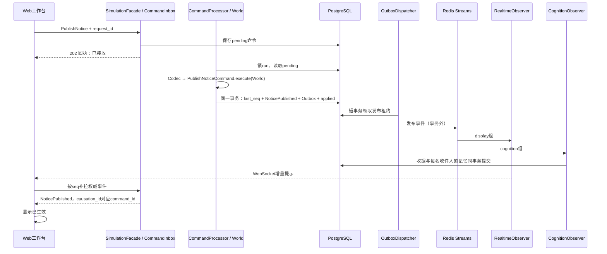
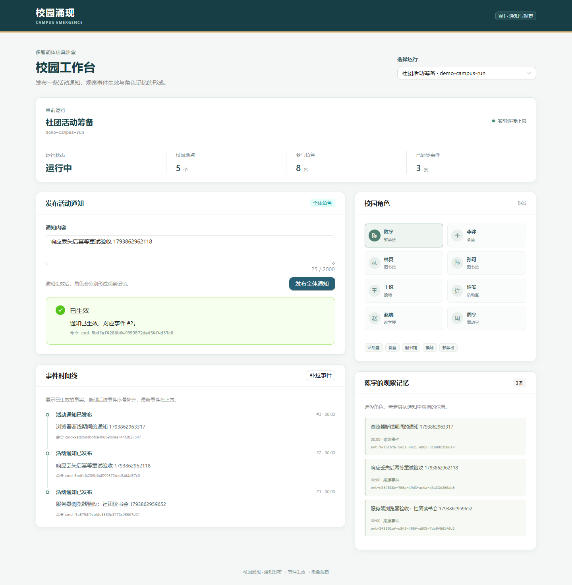

# 第三阶段：W1最小端到端纵向闭环

本阶段以“发布活动通知”为切片，沿用计划书2.1的分层、UML、GoF及第二阶段契约。运行环境保持frontend、api、runtime、cognition、postgres、redis六个服务，数据库迁移版本保持`0002_core_schema`。

## 1. 启动与初始化

首次启动，在仓库根目录复制`.env.example`为`.env`，再执行：

```bash
docker compose config --quiet
docker compose up --build -d --wait
docker compose exec -T api python -m app.seed
```

默认浏览器入口为`http://localhost:5173`，API文档为`http://localhost:8000/docs`。API先执行`alembic upgrade head`，Worker随后启动；初始化需显式执行，不在每次启动时重置数据。

初始化返回`{"run_id":"demo-campus-run","created":true}`。再次执行返回`created:false`，不覆盖原运行的状态、seq、角色位置、配置、事件或记忆。首次创建在一个事务内插入运行、5个地点与8名角色，陈宇位于教学楼。默认运行直接处于`RUNNING`，仿真时间为0，便于只演示通知切片；本阶段没有推进仿真时钟。

需要另一份演示运行时执行`python -m app.seed --run-id another-demo-run`。运行共享开发模板，分别持有自己的配置快照和状态。现有运行不做自动修复或重置。

本机开发沿用README的虚拟环境及PostgreSQL/Redis连接设置，从`backend/`执行`python -m alembic upgrade head`、`python -m app.seed`，分别启动API、Runtime、Cognition；前端执行`npm ci`和`npm run dev`。

## 2. 样板调用链与分工



| 负责方向 | 主要样板文件 | 扩展时遵守的边界 |
| --- | --- | --- |
| A：World与事务 | `domain/campus_world.py`、`application/command_processor.py`、`infrastructure/postgres/repositories.py` | 领域不访问数据库/Redis/模型；先锁run，再在同一UoW提交全部权威效果 |
| B：分发与观察 | `application/outbox_dispatcher.py`、`infrastructure/postgres/dispatch.py`、`cognition/observers.py`、`infrastructure/postgres/observations.py` | 外部发布不持世界事务；消费者收据与数据库副作用同事务，提交后ACK |
| C：API与前端 | `api/workbench.py`、`application/workbench.py`、`infrastructure/postgres/workbench.py`、`frontend/src/features/` | 传输DTO与读取服务分开；WebSocket只提示，REST事件是生效依据 |

Command、State、Observer和Facade在此切片中实际参与调用。Strategy、ModelGateway和历史Memento恢复仍保留接口，不在本阶段调用。具体依赖由`bootstrap.py`和各进程入口装配。

## 3. 接口与状态反馈

| 接口 | 用途 |
| --- | --- |
| `GET /runs` | 最近100个运行及状态 |
| `GET /runs/{run_id}/state` | 当前状态、seq、地点和角色位置 |
| `POST /runs/{run_id}/commands` | 保存命令并返回202回执 |
| `GET /runs/{run_id}/commands/{command_id}` | 查询已接收/已生效/已拒绝结果 |
| `GET /runs/{run_id}/events?after_seq=0&limit=100` | 增量事件页：items、next_seq、has_more |
| `GET /runs/{run_id}/agents/{agent_id}` | 角色信息及最近100条观察记忆 |
| `WS /runs/{run_id}/updates` | API实际路由；浏览器通过`/ws/runs/{run_id}/updates`访问 |

浏览器HTTP请求仍使用`/api`代理；Vite和Nginx分别去除`/api`、`/ws`前缀。HTTP路由不承担Runtime执行，也不直接调用模型。

提交示例：

```json
{
  "request_id": "notice-demo-request-001",
  "type": "PublishNotice",
  "schema_version": 1,
  "payload": {
    "content": "今晚19点在活动室举行社团读书会，欢迎参加。",
    "recipient_agent_ids": []
  }
}
```

空收件人列表表示全体通知；Runtime在`NoticePublished.payload.recipient_agent_ids`中固化实际收件人的ID。内容不能为空白，最多2000字符；未知角色、不支持的命令/版本或非法payload在Runtime产生明确的拒绝回执。`PAUSED`下通知最终拒绝，不保留pending，恢复运行后不会自动执行该通知；其它不能执行的运行状态也拒绝，完整运行控制另行实现。

通知拒绝通过命令结果及原因表达，不生成通知事件；`ActionRejected`留给后续行动业务。当前通知是因果链的根命令，命令与事件的`correlation_id`均使用该`command_id`；后续衍生命令必须继承根`correlation_id`，并以`causation_id`记录直接原因，不能照搬每条命令各自重置追踪标识的方式。

`request_id`全局唯一。同一请求的运行、类型、版本和规范化payload相同时返回原command_id；改变内容或目标运行返回409。并发提交由数据库唯一约束保护。传输失败时前端保留原request_id与原payload供重试，用户需要另发通知时才创建新请求。

202表示命令已保存。前端先显示“已接收”；即使回执已经是applied，也要查到`causation_id == command_id`的权威`NoticePublished`才显示“已生效”。rejected回执显示“已拒绝”及原因。格式错误、404、409和数据库暂不可用有独立反馈。

## 4. 分发、幂等与恢复

- `CommandProcessor`持有run行锁，分配运行内seq；事件、Outbox、命令结果及世界版本在一个显式事务中提交。事务失败后命令仍可重试，不留下半条通知。
- `PostgresDispatchQueue`利用`next_attempt_at`保存15秒发布租约，在短事务后释放连接。Redis发布在事务外；同run较早未发布事件会阻挡后序事件。失败指数退避，上限30秒。发布成功但标记失败可能造成重复投递。
- `display`和`cognition`使用两个独立消费组。消息副作用成功后才XACK；失败消息留在pending，由XAUTOCLAIM回收。每次启动生成独立consumer名称。
- 认知端检查消息与PostgreSQL权威事件一致。`(consumer_name,event_id)`收据与8条广播观察记忆同事务提交，记忆ID由事件和角色确定性生成。重复消息或提交后未ACK的重试不会重复写记忆。
- 展示端以同样的收据去重，只向订阅该run的连接广播`run_id/seq/event_id`。慢连接有超时隔离。WebSocket不承担可靠存储；发送后进程崩溃可能重复提示，前端按event_id去重。
- API与Cognition分别运行独立的PostgreSQL补偿循环，查找没有本消费组收据的已提交通知，即使Redis暂不可用或Stream丢失，也能补处理。这条路径可能早于Outbox发布，不能仅凭记忆出现就断言Streams已经消费；验收需同时检查XINFO GROUPS及XPENDING。
- 前端每2秒增量补拉，并在WebSocket连接/消息/重连、窗口重新聚焦、网络恢复时补拉。分页只推进到已经连续收到的seq；切换运行会隔离事件和待提交请求。

新增环境变量：`EVENT_STREAM`（默认`campus:events`）、`CONSUMER_RETRY_IDLE_MS`（默认1000）、`CONSUMER_RECONCILE_INTERVAL_SECONDS`（默认3）。其余沿用README。

## 5. 检查命令与手工验证

从仓库根目录运行普通后端测试：

```powershell
.\.venv\Scripts\python.exe -m pytest backend/tests -q
```

真实依赖测试只在独立测试库执行，库名须包含test，且需预先应用迁移。设置`RUN_POSTGRES_TESTS=1`及`RUN_REDIS_TESTS=1`；连接变量指向该库和测试可用Redis。测试只操作自己的UUID命名Stream及所属数据，不清空共享Redis或业务库。

```bash
cd frontend
npm test
npm run typecheck
npm run build
```

手工验收顺序：

1. 初始化两次，确认第二次created:false，地点5个、角色8名，陈宇仍在教学楼。
2. 浏览器发布通知，先见已接收，再见与本次command_id对应的时间线事件和已生效；打开陈宇记忆确认来源事件一致。
3. 用相同request_id及payload重投，确认command_id、事件数和记忆数不变；改变内容重投应返回409。
4. 查看两个消费组及pending，确认分别读取消息；每个全体通知有8条记忆、每组1条收据。
5. 断开浏览器网络，后台发布通知，再恢复网络，确认按旧seq补拉且时间线没有重复。
6. 在受控验收窗口暂停Cognition、重复发布同一事件、恢复Cognition，确认处理继续且记忆不重复。
7. 短暂停止Redis后提交通知，确认权威事件保留；恢复Redis，确认Outbox最终发布、两个组正常处理，无重复业务效果。结束后恢复六服务健康。

## 6. 实际验证结果

以下均为2026-11-05实际执行结果。机器可读证据见[第三阶段验收结果](stage3-verification-results.json)。

| 检查 | 实际结果 |
| --- | --- |
| 本地后端测试 | 135项通过；真实依赖测试未开启时有9个跳过记录，未计为通过 |
| 真实PostgreSQL/Redis测试 | 175项通过，包括39项PostgreSQL和1项Redis测试；在旧镜像挂载源码及最终新镜像中分别运行通过 |
| 前端检查 | 6项逻辑测试、TypeScript检查及生产构建通过；仅有包体积提示 |
| 镜像构建 | 前后端镜像实际构建成功；api/runtime/cognition共用相同后端镜像ID |
| 原环境迁移 | 从`0001_baseline`升级至`0002_core_schema`，`alembic check`无新增操作 |
| 初始化 | 首次created:true，再次created:false；5地点/8角色；实际已有通知后重跑初始化，seq、事件、记忆、收据均未改变 |
| 实际浏览器端到端 | 10项通过：真实WebSocket、已接收→精确事件生效、8名角色记忆、请求去重与409、拒绝结果、已发出请求的响应丢失后原请求重试、断线补拉、增量分页、无未捕获异常 |
| Runtime故障恢复 | 停止Runtime期间命令保持已接收且无事件；重启后只生效一次 |
| Cognition故障恢复与重复投递 | 停止Cognition后发布通知并额外重复投递2次；恢复后该事件恰好8条记忆、1条认知收据 |
| Redis故障恢复 | 停止Redis期间通知仍提交权威事件，Outbox记录重试；就绪检查503。恢复后发布完成，记忆未重复，就绪恢复 |
| 两个Streams消费组 | `display/cognition`各读完8次投递，pending=0、lag=0；6条权威通知共48条观察记忆、12条消费收据 |
| 原数据与部署结构 | 保留原PostgreSQL/Redis容器及两个命名卷；仍为6个服务，4个带探针服务healthy、2个Worker running，无异常重启 |

数据库备份保存在服务器项目目录`stage3-backup-20261105/campus-before-stage3.dump`，已检查PGDMP格式，并保留原源码、Compose及私有环境配置备份。部署继续使用原项目名、回环绑定和端口：前端33931、API49631。构建使用此前获准的Docker镜像源及项目级临时SSH代理；代理未写入镜像运行环境，验收结束后关闭隧道。

容器保留检查首轮误将原前端容器ID作为PostgreSQL预期值，业务与故障检查已通过；随后按第一阶段验收记录中的准确ID进行了只读复核并通过，未因此修改应用代码。机器记录保留了这一验收脚本修正说明。

服务器访问方式（在自己的终端保持隧道连接）：

```bash
ssh -L 15173:127.0.0.1:33931 -L 18000:127.0.0.1:49631 ubuntu@SERVER_HOST
```

然后访问`http://localhost:15173`，API文档为`http://localhost:18000/docs`。服务器更新使用原目录`/path/to/multiAgentVillage`，已有镜像可执行`docker compose up -d --no-build --pull never --wait`启动。不要使用`down --volumes`，也不要将回退迁移作为生产回滚手段；回退会删除业务表。



## 7. 未完成事项与限制

本阶段不实现模型决策、角色行动、完整运行控制、仿真时钟推进或历史回放。默认运行由开发初始化直接创建为RUNNING；计划书中“应用重启后恢复PAUSED、用户继续”的完整恢复控制留待运行控制阶段，此通知切片会继续处理持久化pending命令，不提供暂停/继续按钮。

不包含实验编辑、通用命令业务、认证、多租户、指标看板、告警和人工死信管理。未知或损坏的Stream消息会留在pending并记录错误；PG补偿保护本阶段合法已提交通知，不提供通用毒消息修复界面。API展示组的WebSocket管理器是单进程实现，后续扩展多API进程需增加进程间广播，本阶段仍为一个API实例。

开发环境仍只绑定服务器回环地址，通过SSH隧道访问；不开放新的公网端口。前端构建有Ant Design整包体积提示，功能与类型检查通过，按需拆包留待产品完善阶段。
