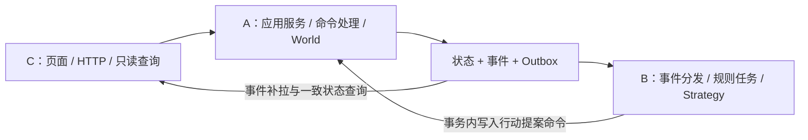

# W2施工总计划：规则运行闭环

已冻结施工口径。A、B、C及各自agent直接按分工实施，无须另行定义业务规则或接口。

## 1. 依据、目标与范围

业务依据始终是[project-plan-v2](../project-plan-v2.md)的2.4、3.2—3.6、3.11和5.1—5.2。本目录只补足W2实施参数、字段与交付归属，不修改主计划。当前代码完成的是通知最小闭环；状态机、移动、规则任务仍待开发，不能把接口占位当作实现。

本迭代完成：**模板编辑保存 → 创建运行 → 校验 → 启动 → 规则行动 → 暂停 → 继续 → 停止 → 重启后保留记录**。采用5地点、8角色、1个活动、1×仿真和原六服务结构。全程不调用模型。

W2只实现MOVE及经世界校验的空闲WAIT规则意图；完整计时等待、TALK、JOIN_ACTIVITY、模型决策、记忆Top-K、场地关闭、历史回放和指标导出仍按主计划后续周次实现。这里的WAIT会进入统一提案链并记录规则决策，不冒充已完成所有等待动作能力。

## 2. 施工文件与优先级

| 文件 | 用途 |
| --- | --- |
| [统一施工契约](contracts.md) | 已冻结的配置、接口、时钟、状态、规则行为、事件和协作边界；三个agent均须读取 |
| [A施工计划](A-runtime.md) | 世界、生命周期、仿真时钟、配置与运行服务、核心仓储及迁移 |
| [B施工计划](B-cognition.md) | 规则观察者、任务Worker、规则策略、可靠分发、依赖装配与部署验收 |
| [C施工计划](C-product.md) | 公开DTO/HTTP、读取视图、配置页面、控制栏、地图与端到端交互 |

主计划的业务逻辑优先；本目录约定的字段、参数和归属是负责人作出的实现决策，执行者不得自行另设一套。发现确实无法实施的冲突时，只报告具体条款、文件和阻塞证据，不自行改规则。

## 3. 三条固定责任线

- **A决定并执行世界变化**，提供合同中已经定义的应用与仓储入口，不负责重新设计合同。
- **B接收事实并提出行动意图**，只写记忆、任务、结果及输入命令，不修改权威位置、时钟或运行状态。
- **C呈现并转发用户意图**，独立用固定示例开发页面；读取数据库可以，业务写入必须调用A的应用入口。

共享文件归属已固定：A负责`domain/commands.py`、事件枚举、仓储端口、ORM和迁移；B负责`domain/decisions.py`、策略、`bootstrap.py`、Worker公共生命周期和Compose新增环境项；C负责`application/workbench.py`、HTTP路由、读取查询和前端。各人提供自己需要的装配工厂，由B集中接入，不同时改装配文件。

## 4. 交付顺序

建议一个迭代、每人约18小时；以可运行交付为节点，不要求成员再开接口定义会。

| 节点 | A必须交付 | B必须交付 | C必须交付 |
| --- | --- | --- | --- |
| 第1工作日 | 固定配置与端口类型、初始化服务骨架、迁移草案 | 按契约制作规则上下文/任务测试替身，先补跑原PG回归 | 按契约制作固定Mock，完成配置及控制页面骨架 |
| 第2—3工作日 | 生命周期、移动、时钟和到期完成可测试 | 首次任务、规则/WAIT唤醒、原子提案和重试可测试 | 固定DTO接口、地图插值、反馈及断线处理可测试 |
| 第4工作日 | 提供真实服务，修复世界执行问题 | 负责组装并运行真实PG/Redis联调 | 切换真实接口，执行完整浏览器流程 |
| 第5工作日 | 世界边界验收与文档 | 六服务验证、故障证据与汇总报告 | 交互验收、2名非开发同学走查与记录 |

开发期间A/B/C各在自己的短分支完成负责文件；B最后组装，不用“等别人先实现完”作为推迟Mock或单元验证的理由。分支合并冲突只处理文件内容，不重新裁定合同。

## 5. 统一验收剧本

1. 从固定模板保存一个新实验，创建DRAFT运行；校验后READY，启动后RUNNING。修改实验不影响已创建运行的快照。
2. 陈宇在教学楼：第5仿真秒日程到时，随后开始前往活动室，固定路线耗时10秒；按实际开始时刻加10秒验收到达。无故障时日程到应用、到期到完成的仿真延迟各不超过1000ms，不允许为凑整点回填开始时间。其余角色按契约日程移动或空闲。
3. 第2秒暂停，等待若干墙钟秒，仿真时间与显示位置保持；继续后第5秒仍只产生一次移动。移动中再次暂停，继续后位置无跳跃。
4. 重复提交/投递10次，原命令、规则任务和行动不重复生效。停止后旧提案和完成命令失效。
5. 重启时，按主计划3.6将所有未结束运行恢复/保持PAUSED并记录原因；用户继续前重新校验。DRAFT/READY的恢复例外也已在契约中规定，不由执行者裁定。
6. 刷新、网络断开重连可恢复权威观察；原通知、记忆和时间线功能回归通过。新增PG并发与真实Redis用例必须实际执行，跳过不算通过。

本次只分发施工文档；代码和主计划不随本次文档更新而改变。原W1真实模型连通性预研仍为单独待补项，不能被本轮零模型演示替代。
