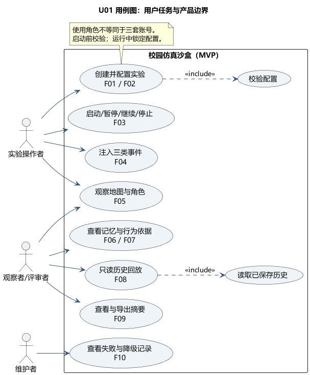
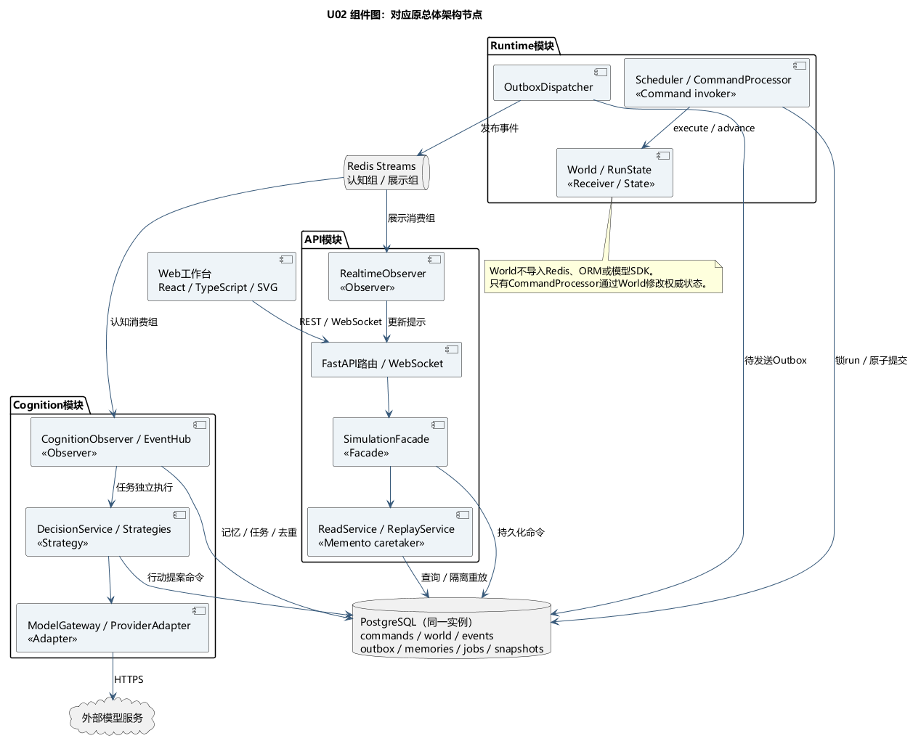
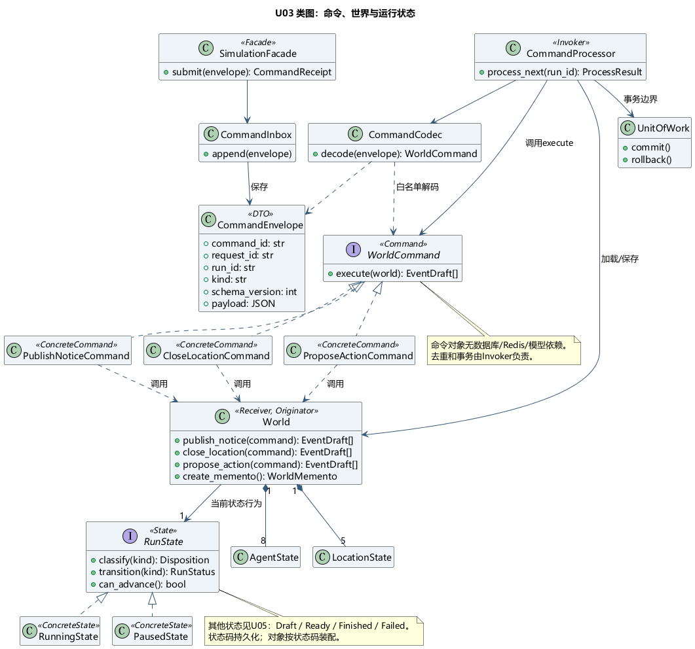
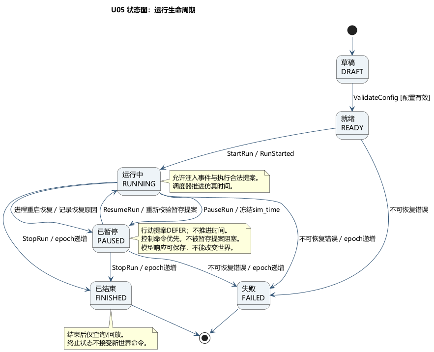
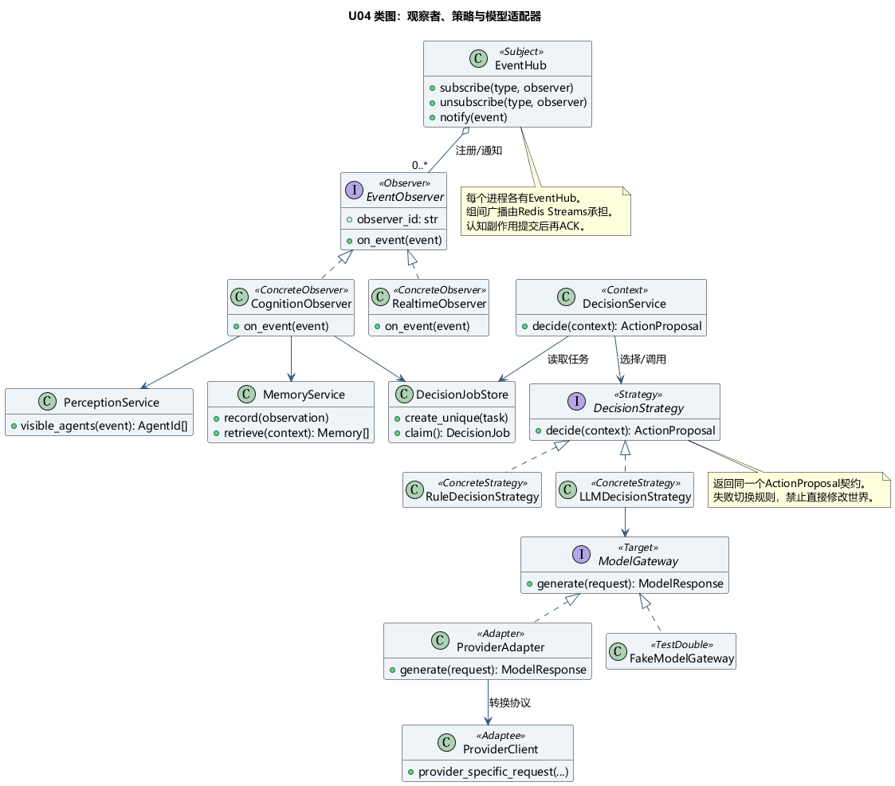
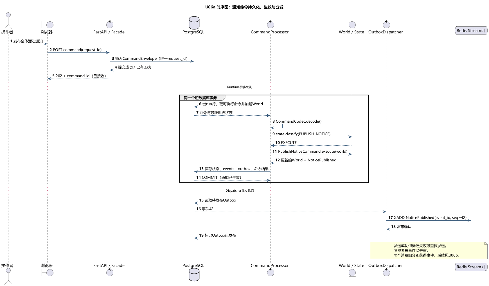
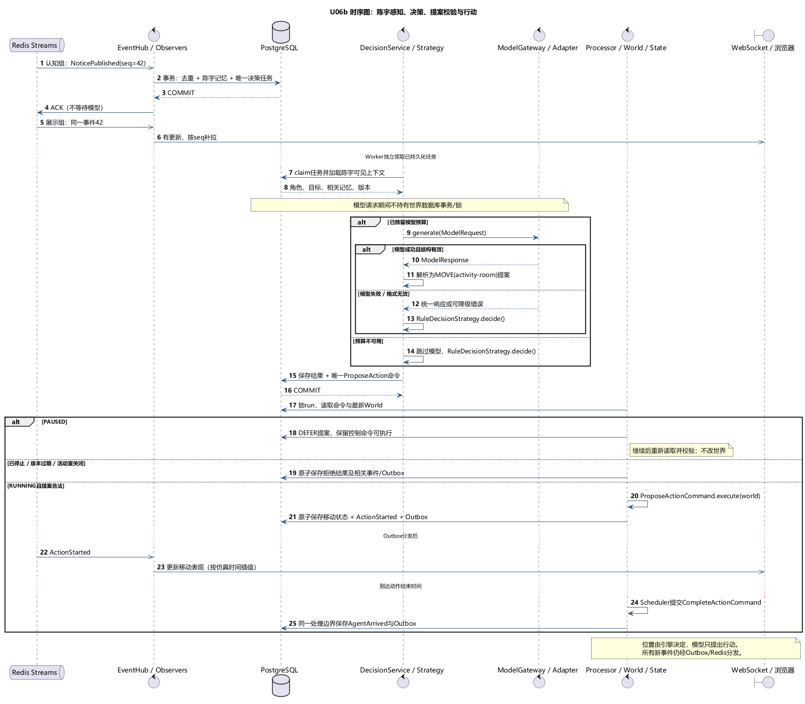
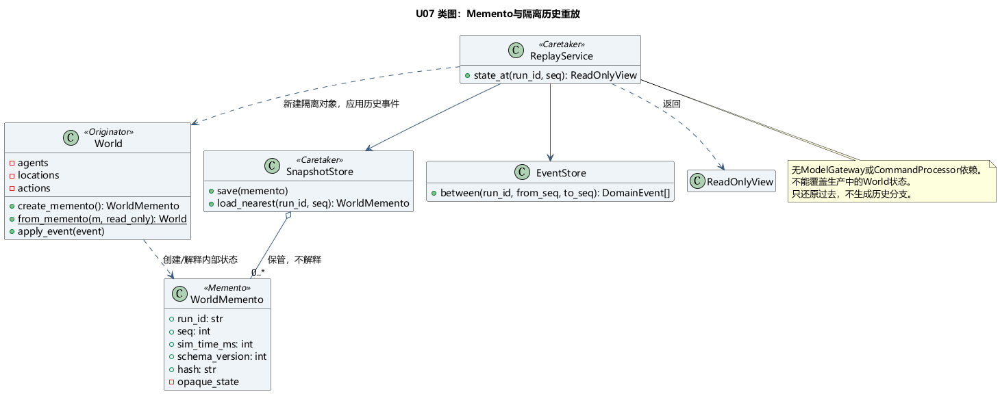
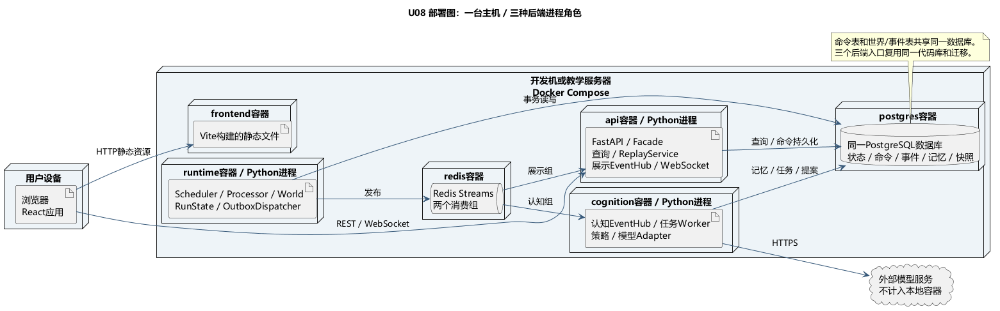

### 3.11 UML与GoF实现约定

本节用UML和GoF将3.2的职责落实为类、接口和协作约定，供组员实现与联调。

UML图使用PlantUML保存图源，模式名称采用GoF目录。

#### 3.11.1 阅读顺序、图例与追踪关系

按用例→组件→类与状态→时序图阅读。[图源与生成说明](README.md)提供9张PNG及`.puml`文件；`<<Command>>`等为项目标签，不是额外UML Profile。

类图：实线/虚线空心三角分别表示继承/接口实现，虚线箭头表示依赖，实线箭头表示关联，实心菱形表示组合；`1`、`0..1`、`0..*`表示数量约束。

| UML视图 | 回答的问题 | 对应需求/原章节 | 主责与使用时机 |
| --- | --- | --- | --- |
| U01 用例图 | 谁通过系统完成什么任务？ | F01—F10；第2节 | C主责，W1确认产品边界 |
| U02 组件图 | 原架构图的节点对应哪些软件组件？ | 3.1、3.2、3.8 | A主责，W1约定依赖方向 |
| U03 命令/世界/状态类图 | 谁接收命令，谁执行，谁允许改世界？ | F03、F04；3.3、3.5、3.6 | A主责，W1—W2建立接口 |
| U04 认知类图 | 谁感知事件、选择算法、接入模型？ | F06、F10；3.7 | B主责，W2—W3实现 |
| U05 运行状态图 | 暂停、恢复、停止时什么行为允许执行？ | F03；3.6 | A与C共同审阅，W2实现 |
| U06a 命令生效时序图 | 命令何时真正生效，事件何时发布？ | F04、F07；3.4、3.5 | A/B/C共同联调，W2 |
| U06b 认知与行动时序图 | 模型等待与世界状态变化如何协调？ | F05、F06、F10 | B主责，A审查，W3—W4 |
| U07 快照类图 | 如何封装状态并只读还原历史？ | F08；3.9 | A主责，W5 |
| U08 部署图 | 组件放在哪个进程，哪些资源共享？ | 3.1、3.8；部署验收 | B主责，W1建立、W7复核 |

#### 3.11.2 用例与组件视图



U01沿用2.1的使用角色；`include`表示每次必执行的子用例。“查看行为依据”可直接进入。



U02使用3.2定义的组件名称与职责，进程分组见U08。数据节点分开绘制仅表示数据职责，`commands`、世界状态、`events`和`outbox`属于同一个PostgreSQL实例。

#### 3.11.3 GoF应用总表

组件职责以3.2为准。本表定义模式角色与扩展点；共享接口的小类可放在同一文件。

| 模式 / 类型 | GoF角色与组件 | 实现与扩展约定 |
| --- | --- | --- |
| Command / 行为型 | Client=`SimulationFacade`、`DecisionService`；Invoker=`CommandProcessor`；Command=`WorldCommand`；ConcreteCommand=`PublishNoticeCommand/CloseLocationCommand/ProposeActionCommand`；Receiver=`World` | 用户命令与行动提案统一排队和执行。新增命令时补充契约、解码注册及测试；复用3.4的事务流程 |
| Observer / 行为型 | Subject=`EventHub`；Observer=`EventObserver`；ConcreteObserver=`CognitionObserver/RealtimeObserver` | 按事件类型注册观察者；跨进程分发使用Redis Streams消费组，可靠性遵循3.5 |
| Strategy / 行为型 | Context=`DecisionService`；Strategy=`DecisionStrategy`；ConcreteStrategy=`LLMDecisionStrategy/RuleDecisionStrategy` | 替换决策算法，统一返回`ActionProposal`；失败切换记录来源与原因，提案仍由`World`校验 |
| State / 行为型 | Context=`World`；State=`RunState`；ConcreteState=`DraftState/ReadyState/RunningState/PausedState/FinishedState/FailedState` | 状态对象控制授权、迁移与时钟；运行规则见3.6及U05，实例与数据库状态码保持一致 |
| Adapter / 结构型 | Client=`LLMDecisionStrategy`；Target=`ModelGateway`；Adapter=`ProviderAdapter`；Adaptee=供应商SDK/HTTP客户端 | 更换供应商时保留`generate(ModelRequest)`接口，仅转换协议、异常与用量 |
| Facade / 结构型 | Facade=`SimulationFacade`；子系统=`CommandInbox/ReadService/ReplayService` | 保持前端提交与查询入口稳定；`submit()`保存命令后返回回执，不同步执行世界动作或模型请求 |
| Memento / 行为型 | Originator=`World`；Memento=`WorldMemento`；Caretaker=`SnapshotStore/ReplayService` | `World`封装、导出及还原状态，存储组件只保管；按3.11.7隔离回放 |

UML用于表达结构和交互，GoF用于约定对象协作。Outbox、Repository、UnitOfWork和跨进程发布订阅属于其他设计机制。注册表不称为Factory Method，单Runtime部署不称为Singleton；命令表、状态枚举、Redis和JSON备份各自都不足以构成完整GoF模式。[UML规范](https://www.omg.org/spec/UML/2.5.1/About-UML)、[GoF原书](https://www.informit.com/store/design-patterns-elements-of-reusable-object-oriented-9780321770462)

#### 3.11.4 命令与状态类图



`CommandProcessor`通过`CommandCodec`解码已保存的`CommandEnvelope`，再调用`WorldCommand.execute(world)`，执行顺序见3.4。命令对象不持有数据库Session、Redis连接或模型客户端；只保存白名单JSON，禁止pickle和按请求类名动态导入。

`World`返回`EventDraft`，由`CommandProcessor`在持锁事务中补全事件信封。领域拒绝保存原因并提交；数据库异常等技术失败回滚后有限重试。本期不实现历史Undo；一个`World`对应一次运行。



| 当前状态 | 控制命令 | 新注入事件/到期动作 | 已返回行动提案 | 仿真时钟 |
| --- | --- | --- | --- | --- |
| DRAFT | 校验配置到READY | 拒绝 | 拒绝 | 停止 |
| READY | 启动到RUNNING | 拒绝 | 拒绝 | 停止 |
| RUNNING | 暂停到PAUSED；停止到FINISHED | 校验后执行 | 校验后执行或拒绝 | 推进 |
| PAUSED | 继续到RUNNING；停止到FINISHED | 新注入拒绝；到期动作保留 | `DEFER`，继续后重新校验 | 冻结 |
| FINISHED/FAILED | 查询/回放；不接受新世界控制 | 拒绝 | 拒绝/失效 | 停止 |

控制命令优先，避免被DEFER提案阻塞。相同request_id返回原回执；不同request_id的重复控制操作根据当前状态返回幂等无变化或拒绝，不重复产生效果。

`RunState.classify(kind)`决定处理方式，`transition(kind)`返回目标状态，`can_advance()`决定时钟是否推进。数据库存状态码，加载时映射为状态对象；状态迁移与`World`一起提交，失败不更新进程缓存。恢复和run_epoch规则见3.6；终止性失败同样递增run_epoch。

#### 3.11.5 认知、决策与模型类图



API和Cognition进程各自持有`EventHub`，通过`EventObserver.on_event(event)`通知本地对象；进程间由Redis Streams分发。同一消费组内的观察者按`observer_id`去重，必要处理全部成功后才ACK。`CognitionObserver`将去重记录、观察记忆和决策任务放在同一事务；`DecisionService`独立领取任务，模型调用不占用消费事务。

`DecisionService`向`DecisionStrategy`传入`DecisionContext`。两种策略返回相同的`ActionProposal`；模型失败或预算不足时选择`RuleDecisionStrategy`，记录`source=rule`与原因，不能以空结果代替降级。

`LLMDecisionStrategy`负责提示词、提案解析与格式校验；`ModelGateway`定义统一请求/响应，`ProviderAdapter`转换供应商协议、异常和用量；`World`校验行动合法性。WebSocket发送不与数据库提交构成原子事务，Web工作台断线或遗漏通知后主动同步状态并按seq补拉。

Python接口使用`Protocol`，不可变消息使用`dataclass(frozen=True)`，必要时使用`ABC`；输入仍需Pydantic运行时校验。[Python Protocol](https://docs.python.org/3/library/typing.html#typing.Protocol)

#### 3.11.6 时序图：陈宇收到通知后前往活动室

陈宇在教学楼收到全体活动通知，决定前往活动室。两张图通过`event_id/correlation_id`关联，具体步骤遵循3.4。



U06a区分命令保存、世界事务提交和异步发布三个时点：保存后返回202，提交后生效，随后由`OutboxDispatcher`分发。



U06b展示`CognitionObserver → DecisionService → DecisionStrategy → ModelGateway → ProviderAdapter`生成提案，再以`ProposeActionCommand`进入`CommandProcessor → World`。到达时间由`Scheduler`检查并提交`CompleteActionCommand`，通过相同事务边界生成`AgentArrived`。

暂停、过期与模型失败分支分别遵循3.6、3.5和3.7；模型等待不持有世界数据库锁。提案使用角色计划及相关资源版本，不能因为无关世界变化失效。任务重试可能重复计费；唯一结果与命令键只防止世界效果重复。

#### 3.11.7 快照与回放类图



`World.create_memento()`导出`WorldMemento`，封装状态及run_id、seq、sim_time、schema_version、hash。`SnapshotStore`只保存和读取；`World.from_memento()`校验版本与完整性，创建脱离生产仓储的只读`World`。

`ReplayService`读取最近快照，通过`World.apply_event()`顺序应用后续历史事件，并按指定仿真时间插值。角色详情按时间/seq截断，避免读取未来记忆。可重放数据与快照频率见3.9。

回放对象不持有生产`World`仓储的写入引用，接口不暴露submit/execute；不调用`WorldCommand.execute()`、`DecisionStrategy`或`ModelGateway`。Memento负责封装快照，事件序列补齐快照后的历史；本期不恢复可继续推理的历史分支。

#### 3.11.8 部署视图与建议代码目录



MVP部署保持6个Compose服务：frontend、api、runtime、cognition、postgres、redis。OutboxDispatcher放Runtime进程；ReplayService放API进程；`ProviderAdapter`放Cognition进程。外部模型服务不计入本地容器。组件可拆分不等于本期必须拆进程。

```text
backend/app/
  api/                     # FastAPI路由、WebSocket、传输DTO
  application/
    simulation_facade.py   # Facade：提交与查询入口
    command_processor.py   # Command的Invoker；事务边界
    decision_service.py    # Strategy的Context；回退选择
    replay_service.py      # Memento的Caretaker；只读重放
  domain/
    world.py               # Command的Receiver；Memento的Originator
    commands.py            # WorldCommand与具体命令
    events.py              # 不可变领域事件
    run_states.py          # State接口及状态对象
    decisions.py           # DecisionContext / ActionProposal
    strategies.py          # 决策接口及规则策略
    memento.py             # WorldMemento，封装状态
  cognition/
    observers.py           # CognitionObserver
    perception.py          # 感知范围
    memory.py              # 记忆与检索
    llm_strategy.py        # LLMDecisionStrategy
  ports/
    model_gateway.py       # Adapter目标接口
    repositories.py        # 数据/消息端口
  infrastructure/
    postgres/              # SQLAlchemy、仓储、UnitOfWork、CommandCodec
    redis/                 # RedisStreamTransport、EventHub
    providers/             # ProviderAdapter与测试替身
    realtime.py            # RealtimeObserver
  workers/
    runtime.py             # 调度和命令执行入口
    outbox.py              # OutboxDispatcher异步循环
    cognition.py           # 消费事件、领取认知任务
  bootstrap.py             # 装配对象、注册命令/观察者，管理连接生命周期
```

依赖方向：domain不导入FastAPI、SQLAlchemy、Redis或供应商SDK；application依赖领域对象与端口；infrastructure实现端口；bootstrap把具体实现注入应用服务。处理器在事务内可以调用领域对象，但领域对象不能反向开启数据库事务。

#### 3.11.9 给组员的接口与执行约定

[参考接口文件](reference_interfaces.py)展示名称、类型与协作关系，只用于设计讨论和起步，不含数据库/网络实现，不是可运行后端。

| 契约 | 方法形状 | 关键后置条件 |
| --- | --- | --- |
| `SimulationFacade` | `submit(envelope) -> CommandReceipt` | 唯一请求已保存；不代表世界已改变 |
| `WorldCommand` | `execute(world) -> tuple[EventDraft, ...]` | 只调用World；由CommandProcessor补全事件信封，不得包含网络I/O |
| `CommandProcessor` | `process_next(run_id) -> ProcessResult` | 状态、事件、Outbox、命令结果原子提交；DEFER不阻挡控制命令 |
| `RunState` | `classify(kind)`、`transition(kind)`、`can_advance()` | 对同一输入返回明确授权、迁移与时钟语义 |
| `EventObserver` | `on_event(event)` | 消费副作用按观察者去重；不写权威世界 |
| `DecisionStrategy` | `async decide(context) -> ActionProposal` | 所有策略返回相同动作契约并标明来源 |
| `ModelGateway` | `async generate(request) -> ModelResponse` | 供应商响应归一化；提案仍需策略解析和世界校验 |
| `World` | `create_memento()`、`from_memento()`、`apply_event()` | 回放只还原已保存结果，脱离生产写入链 |

命令处理伪代码（事务方法名表达意图，具体ORM实现由A/B对齐）：

```python
def process_next(run_id):
    with unit_of_work() as tx:
        run = tx.runs.lock(run_id)       # 持锁后再读命令，避免过期缓存
        record = tx.commands.next_eligible(run_id, control_first=True)
        if record is None:
            return IDLE
        if record.is_final:             # 已执行或已拒绝，复用结果
            return record.result
        world = tx.worlds.load(run)
        cmd = codec.decode(record.envelope)
        disposition = world.state.classify(cmd.kind)
        if disposition == DEFER:
            tx.commands.defer(record)  # 继续/停止必须仍可被下一轮选中
            tx.commit()
            return DEFERRED
        if disposition == REJECT:
            events = world.record_rejection(cmd, "run_state")
            result = REJECTED
        else:
            outcome = world.validate(cmd)  # 失败是领域结果，不靠外层异常吞掉
            if not outcome.allowed:
                events = world.record_rejection(cmd, outcome.reason)
                result = REJECTED
            else:
                events = cmd.execute(world)  # Command -> Receiver
                result = APPLIED
        tx.worlds.save(world)
        events = tx.events.append_with_seq(run_id, events)
        tx.outbox.add(events)
        tx.commands.finish(record, result)
        tx.commit()                    # 事务外再分发；异常自动回滚
```

所有世界变化，包括Scheduler生成的到期动作与状态控制，都必须通过同一命令/事务边界；不得由定时器、观察者、`ProviderAdapter`或WebSocket直接更新角色状态。参考代码中省略的业务拒绝、任务领取、事务回滚、取消和恢复逻辑，在对应实现周补齐，不能因为有UML图就视为已完成。

#### 3.11.10 实现顺序与模式验收

人员职责见5.1，逐周交付见5.2，UML图主责见3.11.1。模式实现纳入既有八周计划：W2完成`SimulationFacade`、`WorldCommand`、`RunState`及`EventObserver`闭环；W3完成`DecisionStrategy`与`ProviderAdapter`；W4验证时序图；W5完成`WorldMemento`及`ReplayService`。

模式按以下行为验收：

- 新增`EventObserver`实现无需修改`World`。
- 替换`ProviderAdapter`无需修改`DecisionService`；切换`DecisionStrategy`无需修改`CommandProcessor`。
- `PausedState`阻止提案执行；新增`WorldCommand`复用既有事务处理。
- `ReplayService`还原历史时不调用决策、模型或生产状态写入。

需求、事件契约、UML图、参考接口与实际代码采用相同名称。变更时在同一PR中更新相关图源、预览、接口版本和测试。
